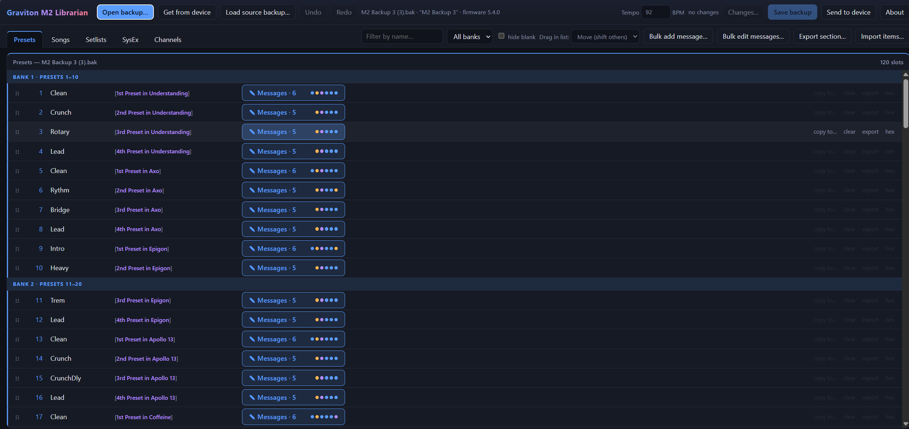

# Graviton M2 Librarian

A browser tool to manage backups (`.bak`) of the **Luminite Graviton M2** MIDI controller.
Unofficial community project, not affiliated with Luminite.

## What it does
- Presets: rename, reorder, copy, clear; edit messages (CC, PC, Tap Tempo incl. enable/disable, Expression CC); bulk add and bulk edit across presets
- Songs and setlists: edit the preset/song lists, song BPM and startup preset; import a song with its presets from another backup
- Channels: names and colours; SysEx slots
- Shows where each preset is used ("1st Preset in <song>")
- Undo/redo, a change list, and a safety check: **only the slots you edit are rewritten**, every other byte is kept, and the tool refuses to save otherwise
- Optional: *Get from device* / *Send to device* over the unit's Wi-Fi mode (`graviton.local`)

## Use it
1. Open the website, or download `index.html` and open it in Chrome/Edge/Firefox.
2. **Open backup…** and pick your `.bak`. (Export one from the unit's web page, or use *Get from device*.)
3. Edit, then **Save backup** (the original is never overwritten) and import it to the unit, or use *Send to device*.

> *Get/Send to device* only work when the page is opened **as a local file** (browsers block https pages from reaching the unit's plain-http web server). The hosted version hides them.

## Privacy
Everything runs in your browser. Backups are never uploaded anywhere.

## Safety and status
- Keep your original backup and try changes on a spare backup slot first.
- Verified on firmware 5.4.0. The tool warns about other versions.
- Hardware-tested: restoring a backup with an edited song. Other edit types follow the decoded layout but have had less hardware testing. Please report what works or breaks.

## Layout notes (for contributors)
`.bak` is 59204 bytes. 120-record tables: presets at 0x6e (81 bytes), SysEx at 0x2666 (79), songs at 0x4b6e (44), setlists at 0x600e (44). Preset: name at +2 (14 bytes), 16 messages of 4 bytes at +16, message count at +80. Message `[type, d1, d2, channel]`: `b0` CC, `c0` PC, `08` Tap Tempo (d1 = tempo, bit 7 = disabled), `0d` Expression CC. See the source for songs, setlists, channel table (0x84aa), song BPM (0xd654) and startup preset (0xd834) tables.

## Licence
MIT, see `LICENSE`. "Luminite", "Graviton" and "M2" belong to their owners.
